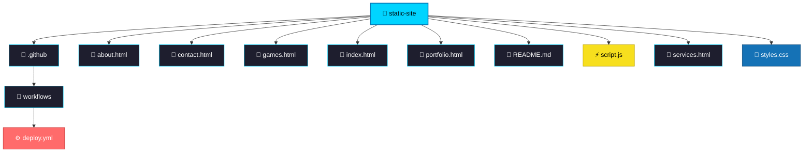
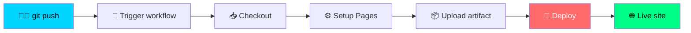

# 🚀 Hello Pages — статический сайт на GitHub Pages

<div align="center">


**✨ Красивый статический сайт из 5 страниц с анимациями, задеплоенный через CI/CD ✨**

[🌐 Живой сайт](https://wrehe0.github.io/hello-pages1/) · [📦 Деплои](https://github.com/wrehe0/hello-pages1/deployments) · [⚙️ Environments](https://github.com/wrehe0/hello-pages1/settings/environments) · [🐛 Issues](https://github.com/wrehe0/hello-pages1/issues)

</div>

---
```
📁 static-site
├── 📁 .github
│   └── 📁 workflows
│       └── ⚙️ deploy.yml
├── 📄 about.html
├── 📄 contact.html
├── 📄 games.html
├── 📄 index.html
├── 📄 portfolio.html
├── 📄 README.md
├── ⚡ script.js
├── 📄 services.html
└── 🎨 styles.css
```
## 📖 О проекте

> Этот проект — практическая демонстрация того, как создать современный статический сайт и **автоматически** публиковать его в интернете при каждом коммите.

Сайт написан на чистых **HTML + CSS + JavaScript** без сборщиков и фреймворков. Дизайн — тёмная тема с неоново-синими акцентами, плавные анимации при скролле и анимированный счётчик на главной странице.

Деплой настроен через **GitHub Actions** — при каждом пуше в ветку `main` сайт автоматически пересобирается и публикуется на **GitHub Pages**.

---

## 🌟 Возможности

- 🎨 **Современный дизайн** — тёмная тема, градиенты, плавные тени
- 🎬 **JS-анимации** — появление элементов при скролле через Intersection Observer
- 🔢 **Анимированный счётчик** — на главной странице
- 📱 **Адаптивная вёрстка** — корректно работает на мобильных
- 🚀 **CI/CD через GitHub Actions** — автоматический деплой при пуше
- 🌍 **Живой URL** — сайт доступен по кликабельной ссылке
- 📊 **История деплоев** — видны во вкладке Deployments

---


## 🗂️ Структура проекта



---

## 📄 Страницы сайта

| # | Страница | Иконка | Описание |
|:-:|----------|:------:|----------|
| 1 | [index.html](index.html) | 🏠 | Главная — hero-секция, анимации, знакомство с проектом |
| 2 | [about.html](about.html) | 👤 | О проекте, команде и целях сайта |
| 3 | [services.html](services.html) | 💼 | Услуги в виде карточек с иконками |
| 4 | [portfolio.html](portfolio.html) | 🖼️ | Портфолио с примерами работ |
| 5 | [games.html](games.html) | 🎮 | Игровой раздел с интерактивом на JS |
| 6 | [contact.html](contact.html) | ✉️ | Форма обратной связи и контакты |

> 💡 **Навигация:** все страницы связаны общим меню в шапке и футером.  
> Стили подключены из одного файла `styles.css`, скрипты — из `script.js`.

---

## 🛠️ Технологии

<div align="center">

| Технология | Назначение |
|:---:|:---|
|  | Разметка страниц |
|  | Стили, Flexbox, Grid, анимации |
|  | Интерактив, Intersection Observer |
|  | CI/CD пайплайн |
|  | Хостинг сайта |

</div>

---

## 🚀 CI/CD Pipeline



**Как это работает:**

1. 🧑‍💻 Разработчик делает `git push` в ветку `main`
2. 🔔 GitHub Actions автоматически запускает workflow
3. 📥 Код клонируется в runner
4. 📦 Артефакт (сайт) загружается
5. 🚀 Деплой на GitHub Pages
6. 🌐 Сайт обновляется по живому URL

---


## 📊 История деплоев

Каждый пуш в `main` создаёт новую запись в разделе **Deployments** репозитория:

👉 [**Смотреть все деплои →**](https://github.com/wrehe0/hello-pages1/deployments)

Каждый деплой содержит:

- ✅ Статус (success / failure)
- 📅 Дату и время
- 👤 Автора коммита
- 🔗 Кликабельную ссылку на задеплоенную версию

---

## ⚙️ Environments

Проект использует GitHub Environment **`github-pages`**:

👉 [**Открыть Environments →**](https://github.com/wrehe0/hello-pages1/settings/environments)

---

## 📁 Структура workflow

```yaml
📁 .github/
└── 📁 workflows/
    └── ⚙️ deploy.yml    # CI/CD пайплайн
```

Файл `deploy.yml` содержит:

- 🔔 Триггер на `push` в `main` и `workflow_dispatch`
- 🔐 Необходимые permissions для деплоя
- 📦 Шаги: checkout → setup-pages → upload-artifact → deploy

---

## 🤝 Как внести вклад

1. 🍴 Форкни репозиторий
2. 🌿 Создай ветку: `git checkout -b feature/amazing-feature`
3. 💾 Закоммить: `git commit -m "Add amazing feature"`
4. 🚀 Запушь: `git push origin feature/amazing-feature`
5. 🔃 Открой Pull Request

---

## 📜 Лицензия

Этот проект распространяется под лицензией **MIT** — используй свободно! 🎉

---

<div align="center">

### 💙 Спасибо за внимание!


</div>
```
